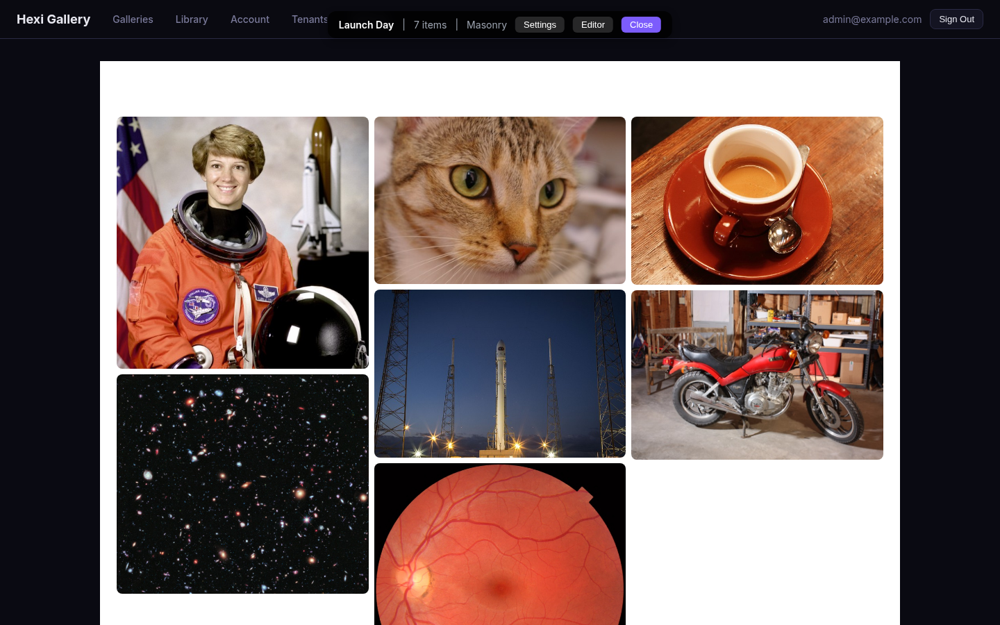
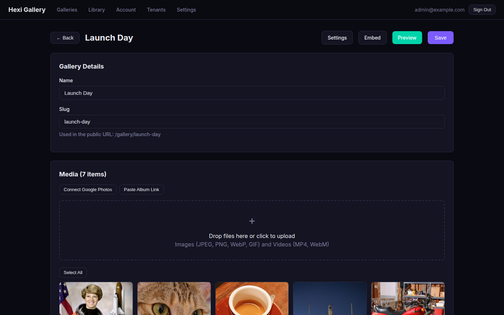
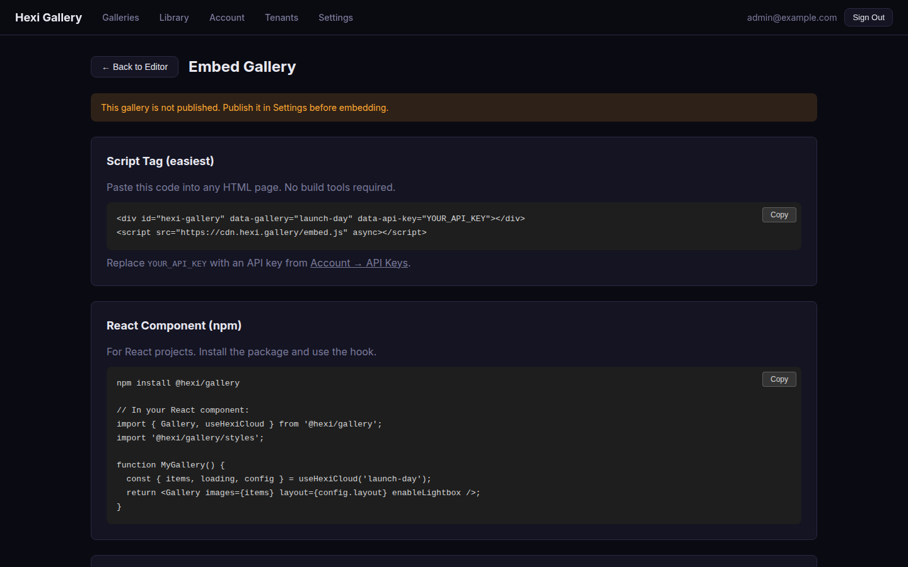
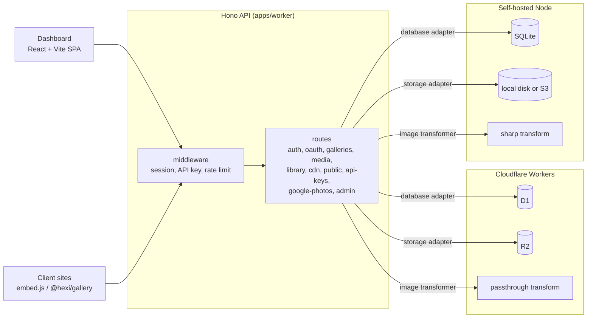

# hexi-studio

A multi-tenant photo gallery platform: a dashboard for building galleries and a media library, an image CDN with URL-based transforms, and a React component and script-tag embed for showing galleries on client sites.

The same Hono API runs on **Cloudflare Workers** (D1 + R2) or **self-hosted on Node** (SQLite + local disk or S3, with sharp for real image transforms). The storage, database and transform layers are adapters, so the route code does not know which one it is on.



| Gallery editor | Embed instructions |
|---|---|
|  |  |

*Screenshots from a local self-hosted instance with sample images from [scikit-image](https://scikit-image.org/).*

## What it does

- **Galleries.** Four layouts (grid, masonry, justified, showcase), drag-and-drop upload and reorder, lightbox, theme and spacing settings, draft or published, private (API key) or public at `/g/:slug` with Open Graph tags for link previews. Images and video (MP4, WebM).
- **Media library.** Standalone, tagged assets (logos, hero images, headshots) that client sites fetch by ID.
- **Image CDN.** `/api/v1/cdn/:tenantId/:mediaId/:variant` with variants such as `w_800,q_75,f_webp` or the `thumb` preset, immutable cache headers and ETags. Self-hosted mode transforms with sharp; on Workers the transform adapter currently passes originals through.
- **Import.** Google Photos via the Picker API, album import and shared-album links.
- **Auth.** Passwordless magic links, Google and Apple OAuth (state + PKCE), an OIDC provider, reusable auto-login links for clients, and per-tenant API keys for the public endpoints (`X-API-Key`).
- **Multi-tenant.** Every row is scoped to a user, with per-tenant storage limits and an admin view of tenants.
- **Embed anywhere.** A script tag (`<div data-gallery="slug" data-api-key="...">` + `embed.js`) or the `@hexi/gallery` React component and its `useHexiCloud()` hook.

## Architecture



```
apps/
  worker/       Hono API: src/index.ts (Workers entry), src/server.ts (Node entry), migrations/
  dashboard/    React SPA
packages/
  gallery/      @hexi/gallery: the React gallery component and useHexiCloud hook (the tested package)
  embed/        embed.js script-tag loader
  shared/       shared types
```

The schema is 13 tables across 9 SQL migrations in `apps/worker/migrations/`: users, sessions, magic-link and auto-login tokens, galleries, media, library media, API keys, OAuth accounts and states, app settings, and Google Photos tokens and imports.

## Engineering decisions

- **One codebase, two runtimes.** The Workers build is the low-ops path; the Node build exists because real image transforms and plain files on a NAS were worth more than zero-ops for some deployments. The adapter boundary (`DatabaseAdapter`, `StorageAdapter`, `ImageTransformer`) keeps the routes identical; D1's prepared-statement API is the shape the SQLite adapter implements.
- **Two-step uploads.** The client asks for an upload URL, PUTs the bytes, then confirms with dimensions. Quota, type and size checks happen before any bytes move.
- **Tokens are stored hashed.** Magic links, auto-login links and API keys are kept as SHA-256 hashes; magic links expire after 15 minutes and are single-use.
- **Transforms in the URL.** Variants are part of the path, so every size is a separate, immutable, cacheable object.

## Quick start (self-hosted, local)

Requires Node 20+ and the `sqlite3` CLI.

```bash
git clone https://github.com/Hexidecibel/hexi-studio
cd hexi-studio
npm install

# Database and storage
mkdir -p data/files
cat apps/worker/migrations/*.sql | sqlite3 data/hexi.db

# API on :4100
cd apps/worker
RUNTIME_MODE=local STORAGE_PATH=../../data/files DATABASE_PATH=../../data/hexi.db \
  PORT=4100 CORS_ORIGIN='*' MAGIC_LINK_BASE_URL=http://localhost:4101 \
  npm run dev:local

# Dashboard on :4101 (proxies /api to :4100), in a second terminal
cd apps/dashboard && npm run dev
```

Open `http://localhost:4101` and sign in with any email. Without SMTP settings the API prints the magic link to its console. `apps/worker/.env.local.example` lists every variable, including SMTP and the OAuth providers; copy it to `.env.local` instead of passing them inline.

### Docker

The `Dockerfile` builds the dashboard and the Node API into one image that serves the SPA at `/` and the API at `/api/v1/*` on port 4100:

```bash
docker build -t hexi-studio .
mkdir -p data/files && cat apps/worker/migrations/*.sql | sqlite3 data/hexi.db
docker run -p 4100:4100 -v "$PWD/data:/data" \
  -e RUNTIME_MODE=local -e DATABASE_PATH=/data/hexi.db -e STORAGE_PATH=/data/files \
  hexi-studio
```

### Cloudflare Workers

Set your D1 database and R2 bucket in `apps/worker/wrangler.toml`, apply each file in `migrations/` with `wrangler d1 execute <db> --remote --file=...`, then `npm run deploy` in `apps/worker`. Build the dashboard with `npm run build` in `apps/dashboard` and host `dist/` on any static host.

## Using it from a client site

```html
<div data-gallery="launch-day" data-api-key="YOUR_API_KEY"></div>
<script src="https://<your-host>/embed.js" async></script>
```

```tsx
import { Gallery, useHexiCloud } from '@hexi/gallery';
import '@hexi/gallery/styles';

function LaunchDay() {
  const { items, loading, config } = useHexiCloud('launch-day');
  if (loading) return null;
  return <Gallery images={items} layout={config.layout} enableLightbox />;
}
```

`@hexi/gallery` is a workspace package with a release workflow (`.github/workflows/publish.yml`); it is not on the npm registry yet, so install it from the repo for now.

A single library image:

```bash
curl -H "X-API-Key: $KEY" https://<your-host>/api/v1/public/media/<id>
# { id, src, alt, width, height, thumbnail, srcSet }
```

## Tests and CI

```bash
npm run test:run   # Vitest via turbo: 146 tests in 20 files (packages/gallery)
npm run lint
npm run build
```

The [CI workflow](.github/workflows/ci.yml) runs lint, tests and build on every push. The API has no automated tests yet; it is the next gap to close.

## License

[MIT](LICENSE)
